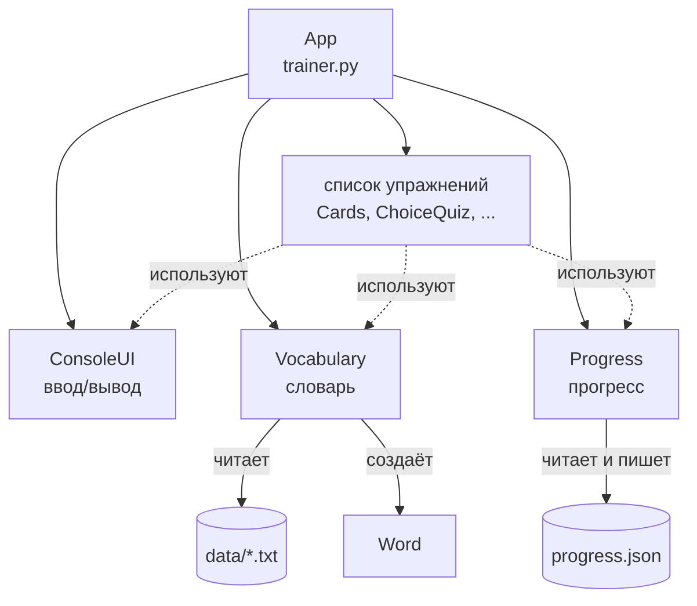
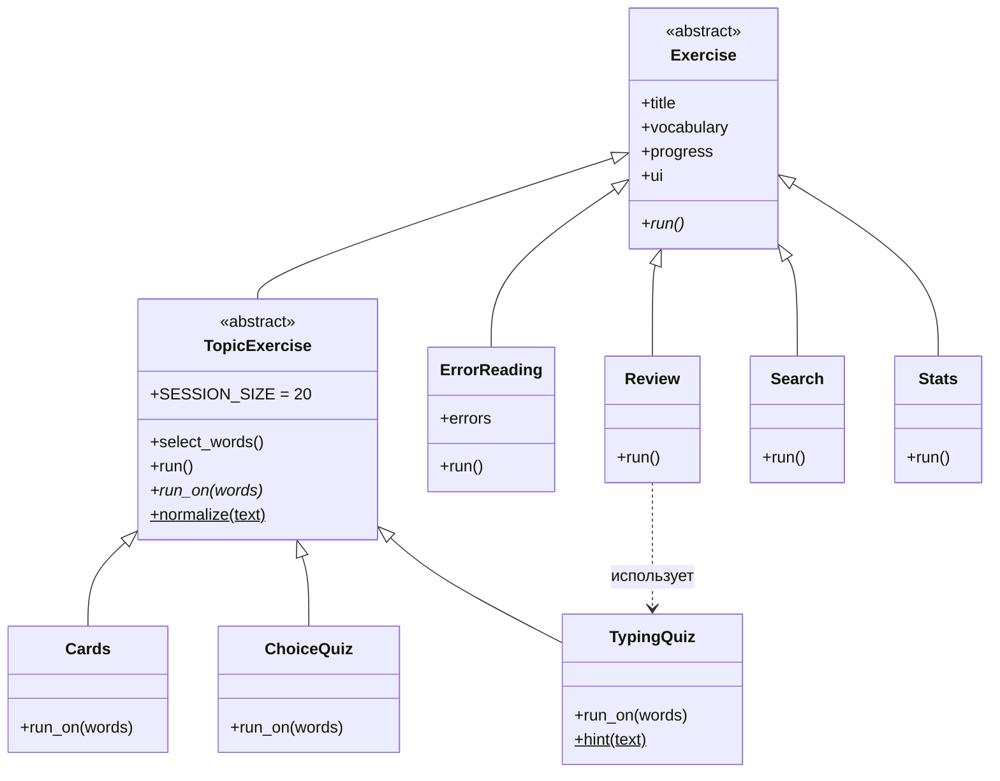

# English for Programmers — справка

Консольный тренажёр английского языка для русскоязычных программистов, которые начинают с нуля.
Цель — научиться **читать техническую литературу, документацию и сообщения об ошибках** на английском.

- 3621 слово в 18 темах — от `print` и `variable` до «however», «under the hood» и «backward compatible»
- произношение русскими буквами для каждого слова
- 20 настоящих ошибок Python с переводом и разбором
- прогресс сохраняется между запусками

---

## Содержание

1. [Как запустить](#1-как-запустить)
2. [Режимы программы](#2-режимы-программы)
3. [Как выбираются слова для занятия](#3-как-выбираются-слова-для-занятия)
4. [Темы словаря](#4-темы-словаря)
5. [Как добавить свои слова](#5-как-добавить-свои-слова)
6. [Устройство кода (ООП)](#6-устройство-кода-ооп)
7. [Принципы ООП на примерах из программы](#7-принципы-ооп-на-примерах-из-программы)
8. [Как добавить новый режим](#8-как-добавить-новый-режим)
9. [Частые вопросы](#9-частые-вопросы)

---

## 1. Как запустить

1. Откройте в VS Code файл `trainer.py`.
2. Нажмите ▷ (**Run Python File**) в правом верхнем углу или `Ctrl+Alt+Z` (Code Runner).
3. Программа работает в терминале: вводите номер пункта и нажимайте Enter.

> Не запускайте программу выделением кода (`Shift+Enter`) — ей нужен весь проект целиком.

Нужен Python 3.10 или новее. Сторонние библиотеки не нужны.

---

## 2. Режимы программы

| № | Режим | Что происходит |
|---|---|---|
| 1 | **Карточки** | Показывает 20 слов: слово, произношение, перевод, пример. Enter — следующее, `q` — выход. |
| 2 | **Тест EN → RU** | Английское слово + 4 варианта перевода. Введите номер правильного. |
| 3 | **Тест RU → EN** | Русский перевод — напишите английское слово. `?` — подсказка (первая буква и число букв). |
| 4 | **Читаем ошибки Python** | Настоящее сообщение об ошибке. Попробуйте понять сами, Enter — перевод, разбор слов и совет. |
| 5 | **Работа над ошибками** | Слова, в которых вы ошибались чаще, чем отвечали верно. Сначала показ, потом проверка. |
| 6 | **Найти слово** | Поиск по словарю — по-английски или по-русски. Удобно при чтении книги. |
| 7 | **Мой прогресс** | Полоски по каждой теме: сколько слов выучено. |
| 0 | **Выход** | |

**Когда слово считается выученным:** 3 или больше верных ответа, и верных больше, чем ошибок.

**Как проверяется ответ в тесте RU → EN:** регистр, лишние пробелы и знаки препинания не важны.
`It Doesn’t work!` и `it doesnt work` — одно и то же. Пояснение в скобках вводить не нужно:
для слова `commit (DB)` правильный ответ — просто `commit`.

---

## 3. Как выбираются слова для занятия

В каждой теме сотни слов, поэтому занятие — это **порция из 20 слов**. Программа выбирает их в таком порядке:

1. **слабые** — слова, в которых вы ошибались;
2. **новые** — на которые ещё не отвечали;
3. **начатые** — уже отвечали, но ещё не выучены;
4. **выученные** — для повторения.

Внутри каждой группы порядок случайный, и в конце порция перемешивается.

Прогресс хранится в файле `progress.json` рядом с программой.
Чтобы начать с нуля — просто удалите этот файл.

---

## 4. Темы словаря

| Тема | Слов |
|---|---:|
| Старт: первые 60 слов | 60 |
| Программирование: основные понятия | 293 |
| Алгоритмы и структуры данных | 203 |
| Компьютер и операционная система | 214 |
| Интернет, веб и сети | 173 |
| Базы данных и SQL | 100 |
| Разработка, Git и тестирование | 217 |
| Отладка, ошибки и сообщения программ | 174 |
| Математика и логика | 166 |
| Безопасность, облака, DevOps и ИИ | 148 |
| Глаголы для чтения технических текстов | 280 |
| Прилагательные (описание и свойства) | 250 |
| Наречия и слова-связки | 277 |
| Существительные из технических текстов | 228 |
| Служебные слова, местоимения и вопросы | 135 |
| Фразы из документации и книг | 244 |
| Общеупотребительные слова | 197 |
| Академическая лексика для книг и статей | 262 |
| **Всего** | **3621** |

**С чего начать:** «Старт» → «Служебные слова» → «Программирование» → «Отладка» → «Фразы из документации».
Слова-связки (`however`, `therefore`, `despite`) особенно важны: без них не понять смысл предложения,
даже если знаешь все технические термины.

> Переводы и произношение русскими буквами приблизительные. Настоящий английский звук буквами
> не передать — со временем сверяйтесь с произношением в онлайн-словаре.

---

## 5. Как добавить свои слова

Слова лежат в папке `data/` в обычных текстовых файлах. Одна строка — одно слово, поля разделены `|`:

```text
# topic: Название темы
английский|русский|произношение
английский|русский|произношение|пример (необязательно)
```

Пример:

```text
# topic: Мои слова
variable|переменная|вэриабл
print|печатать|принт|print("Hello") — вывести текст
```

Правила:

- строка `# topic: ...` начинает новую тему; остальные строки с `#` — комментарии;
- файлы читаются по порядку имён (`00_...`, `01_...`), поэтому называйте новые файлы с номером, например `18_my_words.txt`;
- если слово уже есть в другой теме, повтор пропускается (`check` и `check (text)` считаются одним словом);
- символ `|` внутри перевода использовать нельзя — он разделяет поля.

---

## 6. Устройство кода (ООП)

### 6.1. Файлы проекта

```text
english_for_programmers/
├── trainer.py       App            — точка входа, главное меню
├── models.py        Word, ErrorMessage — данные одного слова / одной ошибки
├── vocabulary.py    Vocabulary     — загрузка словаря и вопросы к нему
├── progress.py      Progress       — статистика ответов, подбор слов
├── ui.py            ConsoleUI      — весь ввод и вывод в терминале
├── exercises.py     Exercise и 7 наследников — режимы тренажёра
├── errors_data.py   ERRORS         — список сообщений об ошибках Python
├── data/*.txt       слова по темам
└── progress.json    ваш прогресс (появляется после первого теста)
```

**Главная идея:** каждый класс отвечает за **одну** вещь.
`Vocabulary` ничего не печатает, `ConsoleUI` ничего не знает о прогрессе,
упражнения не читают файлы сами. Поэтому каждую часть легко понять и поменять отдельно.

### 6.2. Кто из кого создаётся



`App` при запуске создаёт три «инструмента» — `ConsoleUI`, `Vocabulary`, `Progress` — и передаёт
их **каждому** упражнению. Упражнения сами ничего не создают, а пользуются тем, что им дали.

### 6.3. Иерархия упражнений



Обозначения: `*` — абстрактный метод (наследник обязан его написать), `$` — статический метод.

- **`Exercise`** — общий родитель. Хранит `vocabulary`, `progress`, `ui` и требует от каждого наследника метод `run()`.
- **`TopicExercise`** — промежуточный родитель для упражнений «по теме». Он уже умеет спросить тему и подобрать 20 слов (`select_words()`), а его `run()` делает это и вызывает `run_on(words)`. Наследникам остаётся написать только `run_on()` — саму проверку.
- **`Cards`, `ChoiceQuiz`, `TypingQuiz`** — пишут только `run_on()`. Выбор темы им достаётся от родителя бесплатно.
- **`ErrorReading`, `Review`, `Search`, `Stats`** — темы не выбирают, поэтому наследуются сразу от `Exercise` и пишут свой `run()`.

### 6.4. Что делает каждый класс

| Класс | Файл | Отвечает за | Главные методы |
|---|---|---|---|
| `Word` | models.py | данные одного слова | `answer` — слово без пояснения в скобках |
| `ErrorMessage` | models.py | данные одной ошибки Python | — |
| `Vocabulary` | vocabulary.py | загрузка и хранение слов | `topics()`, `words(topic)`, `all_words()`, `distractors(word)`, `search(text)`, `len()` |
| `Progress` | progress.py | статистика ответов | `record(word, ok)`, `is_new()`, `is_weak()`, `is_learned()`, `pick(words, size)` |
| `ConsoleUI` | ui.py | ввод и вывод | `say()`, `ask()`, `header()`, `show_word()`, `choose()`, `result()`, `bar()` |
| `Exercise` | exercises.py | общий вид любого режима | `run()` |
| `App` | trainer.py | сборка и главное меню | `run()` |

### 6.5. Что происходит при запуске — по шагам

1. Python выполняет `trainer.py`. Блок `if __name__ == "__main__":` создаёт `App()` и вызывает `run()`.
2. `App.__init__` создаёт `ConsoleUI`, `Vocabulary` (он читает все `data/*.txt`) и `Progress` (читает `progress.json`).
3. Создаётся список из 7 упражнений, каждому передаются три инструмента.
4. `App.run()` в цикле показывает меню. Пользователь вводит `2` → вызывается `self.exercises[1].run()`.
5. `ChoiceQuiz.run()` (унаследован от `TopicExercise`) → `select_words()` спрашивает тему → `Progress.pick()` выбирает 20 слов → `run_on(words)` проводит тест.
6. После каждого ответа `Progress.record()` сразу сохраняет результат в `progress.json`.
7. Тест закончен — возвращаемся в меню. `0` — выход.

---

## 7. Принципы ООП на примерах из программы

### 7.1. Класс и объект

**Класс** — чертёж, **объект** — вещь, сделанная по чертежу.
`Word` — класс, а `print`, `variable`, `loop` — три объекта этого класса.

```python
word = Word(en="loop", ru="цикл", sound="луп", topic="Программирование")
print(word.ru)   # цикл
```

### 7.2. `@dataclass` — класс для хранения данных (models.py)

```python
@dataclass(frozen=True)
class Word:
    en: str
    ru: str
    sound: str
    topic: str
    example: str = ""
```

`@dataclass` сам пишет `__init__`, `__repr__` и `__eq__`. Без него пришлось бы вручную писать
`self.en = en`, `self.ru = ru` и так далее.
`frozen=True` — объект нельзя изменить после создания (как кортеж): слово не испортится случайно во время теста.

### 7.3. Инкапсуляция — прятать внутреннее устройство (vocabulary.py, progress.py)

```python
class Vocabulary:
    def __init__(self, data_dir):
        self._topics = {}          # подчёркивание: «внутреннее, снаружи не трогать»
        self._load(data_dir)

    def words(self, topic):
        return self._topics[topic].copy()   # отдаём копию, а не сам список
```

Снаружи никто не знает, что слова хранятся в словаре `_topics`. Все обращаются через методы
`words()`, `topics()`, `all_words()`. Если завтра хранить слова в базе данных — поменяется
только `Vocabulary`, остальной код не заметит.

`.copy()` — защита: если кто-то снаружи сделает `words.append(...)`, это не испортит словарь
(помните тему про ссылки: без `.copy()` это был бы тот же самый список).

### 7.4. Наследование — взять готовое у родителя (exercises.py)

```python
class TopicExercise(Exercise):
    def select_words(self): ...   # спросить тему, подобрать 20 слов
    def run(self):
        words = self.select_words()
        if words:
            self.run_on(words)

class Cards(TopicExercise):       # Cards — наследник TopicExercise
    def run_on(self, words): ...  # пишет только своё
```

`Cards`, `ChoiceQuiz` и `TypingQuiz` не повторяют код выбора темы — они **наследуют** его.
Код написан один раз, а работает в трёх местах.

### 7.5. Абстрактный класс — обязательный «договор» (exercises.py)

```python
from abc import ABC, abstractmethod

class Exercise(ABC):
    @abstractmethod
    def run(self): ...
```

`Exercise` — абстрактный: создать объект `Exercise()` нельзя, Python выдаст ошибку.
`@abstractmethod` — это требование: **каждый наследник обязан** написать свой `run()`.
Если забыть — ошибка появится сразу при создании объекта, а не в середине работы.

### 7.6. Полиморфизм — один вызов, разное поведение (trainer.py)

```python
self.exercises[int(choice) - 1].run()
```

Меню не знает, что это за упражнение — карточки, тест или поиск. Оно просто вызывает `run()`,
а каждое упражнение выполняет **свой** вариант. Поэтому в `App` нет длинной цепочки `if/elif`
на каждый режим, а добавить новый режим можно, не трогая меню.

### 7.7. `super()` — вызвать метод родителя (exercises.py)

```python
class ErrorReading(Exercise):
    def __init__(self, vocabulary, progress, ui, errors):
        super().__init__(vocabulary, progress, ui)   # родитель сохраняет общие поля
        self.errors = errors                          # добавляем своё
```

`ErrorReading` нужно на одно поле больше, чем остальным. `super().__init__(...)` просит родителя
сделать его часть работы, а дальше добавляется своё.

### 7.8. Композиция — объект использует другой объект (exercises.py)

```python
class Review(Exercise):
    def run(self):
        weak = [...]   # слабые слова
        TypingQuiz(self.vocabulary, self.progress, self.ui).run_on(weak)
```

«Работа над ошибками» не пишет проверку заново — она создаёт готовый `TypingQuiz` и пользуется им.
Наследование — «является» (`Cards` **является** упражнением по теме),
композиция — «использует» (`Review` **использует** `TypingQuiz`).

### 7.9. Атрибуты класса и константы (progress.py, exercises.py)

```python
class Progress:
    LEARNED_AFTER = 3          # общий для всех объектов Progress

class TopicExercise(Exercise):
    SESSION_SIZE = 20
```

Чтобы изменить размер занятия или порог «выученности», достаточно поменять одно число.
`title = "Карточки (новые слова)"` в каждом упражнении — тоже атрибут класса:
наследник переопределяет значение родителя.

### 7.10. `@property` — вычисляемое поле (models.py)

```python
@property
def answer(self):
    return re.sub(r"\s*\(.*?\)", "", self.en).strip()

word = Word(en="commit (DB)", ...)
print(word.answer)   # commit  — пишем без скобок, как поле
```

Выглядит как обычное поле, но значение каждый раз вычисляется из `en`.

### 7.11. `@staticmethod` — функция внутри класса (ui.py, exercises.py)

```python
class ConsoleUI:
    @staticmethod
    def bar(done, total, width=20):
        ...
        return "█" * filled + "░" * (width - filled)
```

Методу не нужны данные объекта (`self`), поэтому он статический. Это обычная функция,
положенная в класс по смыслу. Другие примеры: `TopicExercise.normalize()`, `TypingQuiz.hint()`.

### 7.12. Магический метод `__len__` (vocabulary.py)

```python
class Vocabulary:
    def __len__(self):
        return sum(len(words) for words in self._topics.values())

len(vocabulary)   # 3621
```

Методы с двойными подчёркиваниями (`__init__`, `__len__`, `__repr__`) Python вызывает сам
в особых ситуациях. `__len__` позволяет писать `len(vocabulary)`, как для списка.

### 7.13. Внедрение зависимостей — передавать инструменты снаружи (trainer.py)

```python
tools = (self.vocabulary, self.progress, self.ui)
self.exercises = [
    Cards(*tools),
    ChoiceQuiz(*tools),
    ...
]
```

Упражнения не создают `Vocabulary` или `ConsoleUI` сами — их **передают** при создании.
Все упражнения работают с одним и тем же словарём и одним прогрессом.
`*tools` — распаковка кортежа: `Cards(*tools)` — то же, что `Cards(vocabulary, progress, ui)`.

---

## 8. Как добавить новый режим

Например, режим «Слово дня». Нужно всего два шага.

**Шаг 1.** В `exercises.py` создайте класс-наследник `Exercise`:

```python
class WordOfTheDay(Exercise):
    title = "Слово дня"

    def run(self) -> None:
        word = random.choice(self.vocabulary.all_words())
        self.ui.header("Слово дня")
        self.ui.show_word(word)
```

**Шаг 2.** В `trainer.py` импортируйте его и добавьте в список:

```python
from exercises import ..., WordOfTheDay

self.exercises = [
    ...,
    WordOfTheDay(*tools),
]
```

Всё — новый пункт сам появится в меню. Меню менять не нужно: это и есть польза полиморфизма.

---

## 9. Частые вопросы

**Русские буквы выводятся «кракозябрами».**
`ConsoleUI` переключает терминал на UTF-8. Если не помогло — запускайте через VS Code (▷), а не через старое окно `cmd`.

**`ModuleNotFoundError: No module named 'models'`.**
Программа запущена не из своей папки или выделением кода. Откройте `trainer.py` и нажмите ▷.

**`ValueError: ... нужно минимум 3 поля через |`.**
В одном из файлов `data/*.txt` ошибка в строке — номер строки указан в сообщении.

**Как сбросить прогресс?**
Удалите файл `progress.json`.

**Как изменить размер занятия?**
В `exercises.py` поменяйте `SESSION_SIZE = 20` в классе `TopicExercise`.
