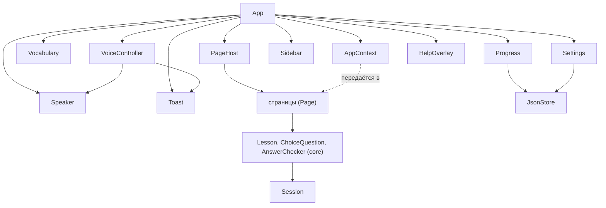
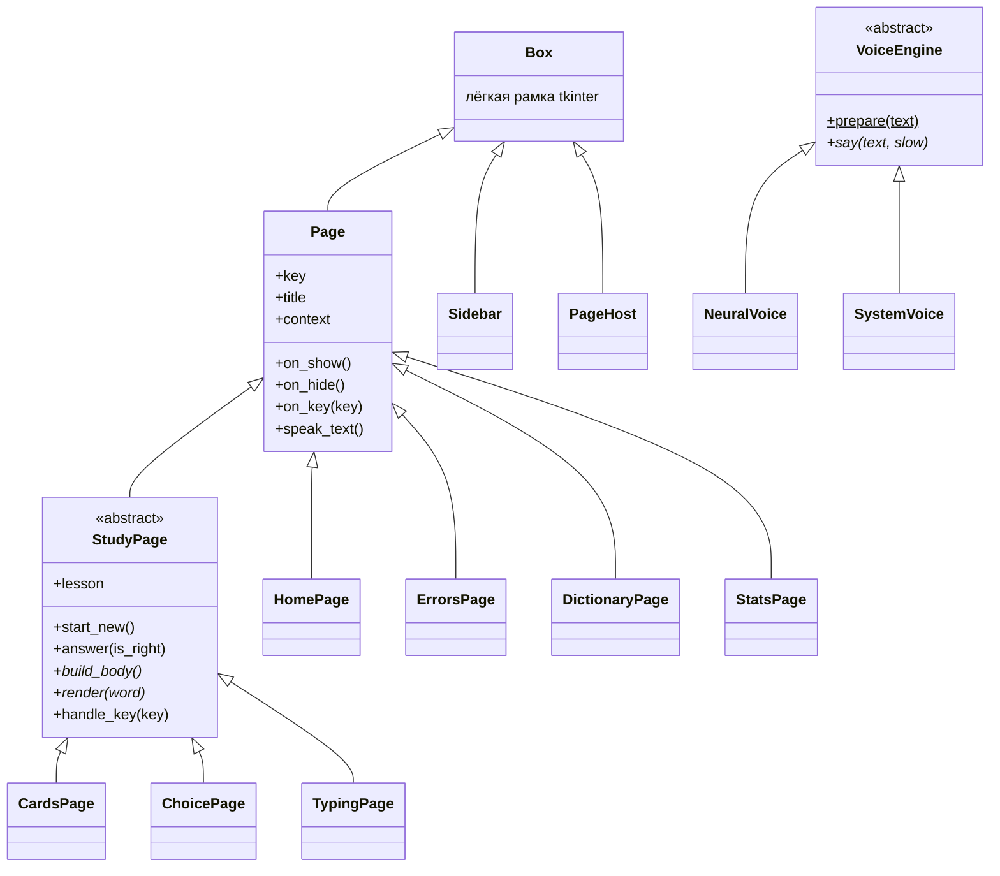

# English for Programmers - графическая версия

Тренажёр английского для русскоязычных программистов с окном, тёмной и светлой темой,
статистикой и графиком занятий. Программа **помнит, где вы остановились**.

Основан на консольной версии (`../english_for_programmers`): тот же словарь из 3621 слова
и те же классы `Word` и `Vocabulary`.

---

## Запуск

**Готовая программа (exe):** ярлык **English for Programmers** на рабочем столе
или `dist/EnglishForProgrammers/EnglishForProgrammers.exe`. Python для неё не нужен.

**Из исходников:**

1. Один раз установите библиотеки: `pip install customtkinter edge-tts`
2. Откройте `main.py` и нажмите кнопку запуска справа вверху (Run Python File).

Нужен Python 3.10 или новее.

### Как собрать exe

```text
python build_exe.py                 собрать и создать ярлык на рабочем столе
python build_exe.py --no-shortcut   только собрать
```

Нужен `pip install pyinstaller`. Результат - папка `dist/EnglishForProgrammers/`:
`EnglishForProgrammers.exe`, служебная папка `_internal/` и `user_data/` с прогрессом.
Папка, а не один файл, потому что так программа запускается примерно за секунду
(один exe-файл при каждом запуске распаковывает себя - около 5 секунд).

- Прогресс exe хранится в `dist/EnglishForProgrammers/user_data/`. При первой сборке туда
  копируется прогресс из исходников, дальше у exe и у запуска через Python **разные** копии.
- Значок нарисован скриптом `tools/make_icon.py` (без графических редакторов) и лежит
  в `assets/icon.ico`. Поменяли рисунок - запустите `python tools/make_icon.py` и пересоберите exe.

---

## Подгон под монитор

При запуске программа сама подстраивается под монитор (`gui/screen.py`):

- открывается на том мониторе, где **указатель мыши** (там, где щёлкнули по ярлыку), по центру;
- размер окна - по монитору: на просторном экране окно больше (1440x900), на обычном 1200x780;
- на **маленьком экране** (ноутбук 1366x768, масштаб Windows 150% на Full HD) весь интерфейс
  пропорционально уменьшается, чтобы окно поместилось;
- на **огромном экране без масштаба Windows** (2560x1440 или 4K при 100%) интерфейс немного
  увеличивается, чтобы текст не был мелким;
- запоминает место, размер и "развёрнуто на весь экран". Если монитор, где было окно,
  отключили - окно откроется по центру текущего;
- если перетащить окно на монитор с другим масштабом, CustomTkinter сам пересчитает размеры.

Расчёт - функция `plan_window(monitor, saved)`, её можно проверить без окна на любых
"воображаемых" мониторах: `plan_window(Monitor(0, 0, 1366, 728, 1.0))`.

---

## Страницы

| Страница | Что делает | Клавиши |
|---|---|---|
| **Главная** | карточка "Продолжить", статистика, дни подряд, слово дня | Enter, 1-4, Пробел |
| **Карточки** | показывается слово, вы открываете перевод и отмечаете "Знаю" или "Не знаю" | Пробел, 1, 2, стрелки |
| **Выбор перевода** | 4 варианта, верный ответ подсвечивается зелёным | 1-4, Enter |
| **Написание слова** | показывается перевод, нужно написать слово по-английски | Enter |
| **Ошибки Python** | настоящие ошибки с переводом и советом | Пробел, стрелки |
| **Словарь** | поиск по-английски и по-русски, статус каждого слова | Esc |
| **Прогресс** | общая полоска, график за 14 дней, прогресс по темам, сброс | нет |

## Озвучка произношения

Слова и фразы произносят **нейросетевые голоса Microsoft** (те же, что читают текст вслух в браузере Edge).
Они звучат как живой человек. Голос выбирается внизу меню: американские Jenny, Andrew, Aria, Guy, Emma, Brian
и британские Sonia, Ryan. Нужна библиотека `pip install edge-tts` и интернет **при первом** произношении слова.

- Каждое слово скачивается **один раз** и сохраняется в `user_data/audio/`. Дальше оно звучит мгновенно и без интернета.
- Слово на экране скачивается **заранее**, в фоне, поэтому по `P` оно звучит сразу.
- Если нет интернета или сервис не ответил за 3 попытки, программа говорит голосом Windows (Zira)
  и один раз показывает предупреждение. Zira можно выбрать и вручную: "без интернета".

- **`P`**: произнести слово или фразу целиком (`let's dive in`, `How does it work?`).
  **`Shift + P`**: медленно. В русской раскладке это клавиша **З**.
- Кнопки **"Произнести"** есть в карточках, выборе перевода, ошибках Python, слове дня, а кнопка **"Звук"** в каждой строке словаря.
- Переключатель **"Произносить сразу"** в меню: каждое новое слово звучит само.
- В "Написании слова" озвучка работает **только после ответа**, иначе она подсказала бы слово.
- Пока курсор в поле ввода (поиск в словаре, написание слова), `P` остаётся обычной буквой.

Как устроено (`core/speech.py`):

| Класс | Что делает |
|---|---|
| `VoiceEngine` | абстрактный "голос": методы `say()`, `stop()`, `close()` |
| `NeuralVoice` | edge-tts: скачивает mp3 в фоновом потоке, кэш, 3 попытки, очередь с приоритетом |
| `SystemVoice` | голос Windows через невидимый процесс PowerShell |
| `Mp3Player` | проигрывает mp3 встроенным в Windows MCI через `ctypes` - без сторонних библиотек |
| `Speaker` | выбирает голос по настройке, при сбое переключается на голос Windows |

Фоновый поток только скачивает файлы и кладёт результат в очередь (`queue.Queue`);
окно каждые 100 мс вызывает `Speaker.poll()` и проигрывает готовое в главном потоке -
tkinter и проигрыватель Windows нельзя вызывать из других потоков.

Сервис ElevenLabs проверялся, но недоступен из региона пользователя (ограничение самой компании).

---

## Горячие клавиши

Программой можно пользоваться без мыши. **F1** - справка со всеми сочетаниями прямо в программе.

| Клавиши | Действие |
|---|---|
| `Ctrl + 1-7` | открыть пункт меню по номеру (номера видны в меню) |
| `Ctrl + Tab` / `Ctrl + Shift + Tab` | следующая / предыдущая страница |
| `Ctrl + F` | поиск в словаре |
| `Ctrl + T` | тёмная / светлая тема |
| `Esc` | на главную (в словаре - сначала очистить поиск) |
| `Ctrl + Q` | выход |
| `Enter` на главной | продолжить с места остановки |
| `1-4` на главной | быстрый старт: карточки, выбор, написание, ошибки |
| `Ctrl + N` | новое занятие |
| `Ctrl + Вверх / Вниз` | выбрать другую тему |
| `Ctrl + R` | повторить ошибки (на экране итогов) |
| `Ctrl + H` | подсказка в "Написании слова" |

Буквенные сочетания (`Ctrl+F`, `Ctrl+N` и другие) работают **в любой раскладке**, и в английской,
и в русской: программа смотрит на физическую клавишу, а не на букву (см. `gui/hotkeys.py`).

В списке тем есть пункт **"Слабые слова"**: занятие только по словам, в которых вы ошибались.
После занятия кнопка **"Повторить ошибки"** сразу запускает повтор неверных слов.

---

## Что программа запоминает

Всё хранится в папке `user_data/`:

| Файл | Что внутри |
|---|---|
| `progress.json` | верные и неверные ответы по каждому слову + число ответов по дням |
| `state.json` | незаконченное занятие **каждого** режима (слова, номер слова, счёт), последняя тема, место в "Ошибках Python", тема оформления, размер и положение окна (и "развёрнуто ли") |

Место остановки сохраняется **после каждого ответа**: программу можно закрыть в любой момент,
при следующем запуске программа откроется на главной, а в блоке "Вы остановились здесь"
кнопка "Продолжить" (или Enter) вернёт к тому же слову.
Чтобы начать всё с нуля - удалите папку `user_data`.

Защита от потери данных (`core/storage.py`, класс `JsonStore`):

- файл пишется сначала в черновик `progress.json.tmp` и только потом подменяет старый.
  Если компьютер выключится посреди записи, старый файл останется целым;
- если файл всё-таки испорчен, программа начинает с пустых данных, но сам файл не стирает:
  он переименовывается в `progress.broken-ДАТА-ВРЕМЯ.json`, а внизу окна появляется сообщение
  об этом. Из такой копии данные можно восстановить вручную;
- при пересборке exe (`python build_exe.py`) папка `user_data` exe-версии на время сборки
  переносится в `build/user_data_backup` и возвращается обратно, даже если сборка упала.

---

## Оформление

Стиль взят с сайта irreplaceable-ai.ru: почти чёрный фон, тонкие едва заметные рамки,
тёплый светлый текст и холодный голубой акцент. Вся графика - один цвет в разных оттенках.

| Роль | Тёмная тема | Светлая тема |
|---|---|---|
| Фон | `#0a0a0b` | `#f6f7f9` |
| Карточки | `#0f1011`, `#15171a` | `#ffffff`, `#f1f3f6` |
| Текст | `#ededec`, второстепенный `#9a9a98` | `#111214`, `#5f646d` |
| Акцент | `#a6c2f5` (голубой) | `#3d6fe0` (синий, читается на белом) |
| Верно / ошибка / изучаю | `#6ee7b7` / `#f4524a` / `#f2903f` | `#12a36b` / `#e0443c` / `#e07b1f` |

Приёмы с сайта:

- метки разделов моноширинным шрифтом: `03 / ВЫБОР ПЕРЕВОДА`;
- заголовок из двух частей, вторая - *курсивом в цвет акцента*: "Карточки. *Слово за словом.*";
- кнопки-"таблетки" с полностью круглыми краями, тонкая линия прогресса;
- на главной - анимированная схема (`gui/diagram.py`), которая показывает, как учится слово:
  на плоскости СЛОВО по буквам печатается английское слово, на плоскости ПЕРЕВОД под
  "дышащим" ядром проявляется перевод, на плоскости ПРАКТИКА загораются три точки - три верных
  ответа, после которых слово выучено, - и становятся мятными. Вокруг плавают слова, которые
  вы сейчас учите (слабые и начатые), время от времени они сменяются.

Шрифты: на сайте Inter и JetBrains Mono, в программе - ближайшие шрифты Windows 11:
**Segoe UI Variable** и **Cascadia Mono**. Все цвета и шрифты - в `gui/theme.py`.

Схема рисуется на `tk.Canvas`. Прозрачности и размытия в tkinter нет, поэтому свечение -
это несколько колец, плавно переходящих от яркого цвета к фону (`theme.mix`). Анимация
работает только на открытой главной странице, один кадр занимает около 3 мс.

---

## Устройство кода (ООП)

```text
english_for_programmers_gui/
|-- main.py                 точка входа: App(...).mainloop()
|-- build_exe.py            сборка exe; keep_user_data бережёт прогресс exe при пересборке
|-- core/                   ЛОГИКА - ничего не знает об окнах
|   |-- models.py           Word, ErrorMessage (@dataclass)
|   |-- vocabulary.py       Vocabulary, parse_words - слова из data/, поиск, варианты ответа
|   |-- questions.py        ChoiceQuestion - вопрос "выбор перевода" с вариантами
|   |-- progress.py         Progress - статистика, статусы, история по дням
|   |-- session.py          Session - одно занятие: слова, номер, счёт, оценка; режимы CARDS...
|   |-- lesson.py           Lesson - ход занятия: темы, подбор слов, ответы
|   |-- answers.py          AnswerChecker - проверка ответа и подсказка
|   |-- settings.py         Settings - state.json: всё, что надо запомнить
|   |-- storage.py          JsonStore - надёжная запись файлов JSON
|   |-- speech.py           VoiceEngine, NeuralVoice, SystemVoice, Mp3Player, Speaker
|   `-- errors_data.py      ERRORS - ошибки Python (данные)
|-- gui/                    ИНТЕРФЕЙС
|   |-- app.py              App - собирает приложение из частей
|   |-- context.py          AppContext, Navigator - что получает каждая страница
|   |-- sidebar.py          Sidebar - боковое меню
|   |-- page_host.py        PageHost - держит страницы, показывает одну
|   |-- voice.py            VoiceController - озвучка для интерфейса
|   |-- toast.py            Toast - всплывающие сообщения
|   |-- help_overlay.py     HelpOverlay - справка по F1
|   |-- diagram.py          LearningDiagram - анимированная схема на главной
|   |-- screen.py           Monitor, Screens, plan_window - подгон окна под монитор
|   |-- hotkeys.py          KeyPress - нажатие клавиши; HELP - список для справки
|   |-- widgets.py          Box, Card, RichText, PageHeader, SectionLabel, StatCard, кнопки
|   |-- theme.py            цвета и шрифты (константы)
|   `-- pages/
|       |-- base.py         Page - общий родитель страниц
|       |-- home.py         HomePage
|       |-- study.py        StudyPage и наследники CardsPage, ChoicePage, TypingPage
|       |-- errors_page.py  ErrorsPage
|       |-- dictionary.py   DictionaryPage
|       `-- stats.py        StatsPage, TopicBars
|-- data/                   слова
|-- tests/                  тесты (unit/ - логика, gui/ - окно, system/ - программа целиком)
`-- user_data/              ваш прогресс, настройки, кэш произношения
```

### Что каждый класс значит "в жизни"

Программу удобно представить как класс в школе. У каждого класса есть понятная роль:

| Класс | Где | Что это в жизни | Что делает |
| --- | --- | --- | --- |
| `Word` | `core/models.py` | карточка из словаря | хранит слово, перевод, произношение, тему, пример |
| `ErrorMessage` | `core/models.py` | карточка с ошибкой Python | текст ошибки, перевод, разбор, совет |
| `Vocabulary` | `core/vocabulary.py` | бумажный словарь с закладками по темам | даёт слова темы, ищет, подбирает неправильные варианты |
| `ChoiceQuestion` | `core/questions.py` | карточка теста с четырьмя вариантами | составляет вопрос, знает номер верного ответа |
| `Session` | `core/session.py` | листок с заданием и счётом | 20 слов, до какого дошли, сколько верно; ставит оценку |
| `Lesson` | `core/lesson.py` | учитель одного упражнения | выбирает слова, принимает ответы, делает закладку |
| `AnswerChecker` | `core/answers.py` | учитель, проверяющий диктант | сравнивает ответ без придирок к регистру и знакам; подсказка |
| `Progress` | `core/progress.py` | дневник ученика | ответы по каждому слову и по дням, статусы, серия дней |
| `Settings` | `core/settings.py` | закладка и записка на холодильнике | где остановились, тема оформления, голос, окно |
| `JsonStore` | `core/storage.py` | сейф для одного файла | пишет файл через черновик, испорченный файл откладывает в сторону |
| `Speaker` | `core/speech.py` | диктор с двумя голосами | выбирает голос, при сбое говорит голосом Windows |
| `NeuralVoice` | `core/speech.py` | диктор со студией звукозаписи | один раз записывает фразу в файл, потом играет с полки |
| `SystemVoice` | `core/speech.py` | запасной диктор | голос Windows, работает без интернета |
| `Mp3Player` | `core/speech.py` | магнитофон | проигрывает файл MP3 |
| `App` | `gui/app.py` | сборщик на конвейере | при запуске создаёт и соединяет все части |
| `AppContext` | `gui/context.py` | пропуск с перечнем доступов | что можно использовать странице |
| `PageHost` | `gui/page_host.py` | папка-скоросшиватель | держит все страницы, открыта одна |
| `Page` | `gui/pages/base.py` | страница тетради с общим оформлением | общий родитель всех страниц |
| `StudyPage` | `gui/pages/study.py` | доска в классе | показывает слово, передаёт ответ учителю `Lesson` |
| `VoiceController` | `gui/voice.py` | пульт диктора | страницы просят "произнеси", пульт передаёт `Speaker` |
| `Toast` | `gui/toast.py` | записка на стикере | сообщение внизу окна на несколько секунд |
| `KeyPress` | `gui/hotkeys.py` | переводчик нажатий | понимает Ctrl+F и в русской раскладке |
| `Monitor`, `WindowPlan` | `gui/screen.py` | паспорт монитора, план расстановки | размер и место окна под экран |

### Пять правил, на которых держится код

1. **Логика отдельно от интерфейса.** Всё, что можно сделать без окна, лежит в `core/`:
   как подобрать слова (`Lesson`), как проверить ответ (`AnswerChecker`), как сохранить прогресс
   (`Progress`). Страницы в `gui/pages/` только показывают данные и передают нажатия.
   Хотите поменять правила - меняете `core/`, интерфейс не трогаете.
2. **Каждый класс отвечает за одно.** `App` только собирает части. Меню - `Sidebar`,
   переключение страниц - `PageHost`, сообщения - `Toast`, озвучка - `VoiceController`.
3. **Страница получает только то, что ей нужно.** Не всё окно, а `AppContext`:
   словарь, прогресс, настройки, озвучку и `Navigator` для перехода на другую страницу.
   Видно, от чего страница зависит, и окно можно менять, не ломая страницы.
4. **Зависимости передаются снаружи** (внедрение зависимостей). `App` принимает
   `speaker=...`, `Speaker` принимает голоса `system=...` и `neural=...`, `Progress` - "часы"
   `today=...`. Программа передаёт настоящие объекты, а тесты - заглушки. Поэтому выбор голоса
   и серия дней в полночь проверяются быстрыми тестами, без звука и без ожидания полуночи.
5. **Объект сам отвечает за своё состояние.** Счёт занятия меняет только `Session`
   (`record_answer`, `skip_word`), а не код снаружи. Методы-вопросы (`current_word`, `active`)
   ничего не меняют, меняют только методы-команды (`start`, `answer`, `restore`).

### Кто кого создаёт



### Иерархия классов



- **`Page`** задаёт "договор" для всех страниц: `on_show()` - страницу открыли, `on_hide()` - ушли,
  `on_key(key)` - нажата клавиша, `speak_text()` - что произнести по `P`.
- **`StudyPage`** - абстрактный класс. Делает всё общее для занятий (экраны, полоска, итог,
  общие клавиши), а логику занятия отдаёт объекту `Lesson`. Наследники пишут только
  `build_body()` и `render(word)`.
- **`App`** не знает, какая страница открыта: вызывает `page.on_show()` и `page.on_key()` -
  это **полиморфизм**.

### Как добавить что-то новое

| Задача | Что сделать |
|---|---|
| Новая страница | класс-наследник `Page` в `gui/pages/`, одна строка в `PAGE_CLASSES` (`gui/app.py`) |
| Новый режим занятий | константа режима в `core/session.py` (и в `STUDY_MODES`), класс-наследник `StudyPage`: `key` = эта константа, `title`, `build_body()`, `render()` |
| Новое правило упражнения | в `core/` (как `ChoiceQuestion` в `core/questions.py`), сначала тест в `tests/unit/` |
| Другие правила проверки ответа | `core/answers.py`, класс `AnswerChecker` |
| Другой размер занятия или подбор слов | `core/lesson.py` (`Lesson.SIZE`) и `core/progress.py` (`Progress.pick`) |
| Новый голос | строка в `VOICES` (`core/speech.py`) |
| Новая горячая клавиша | обработать в `on_key()` страницы через `KeyPress`, строку - в `HELP` (`gui/hotkeys.py`) |
| Другие цвета | `gui/theme.py` |

### Что намеренно не классы

`theme.py` (цвета и шрифты), `HELP` в `hotkeys.py` (список для справки), `VOICES` и `ERRORS` -
это данные и настройки. В Python их принято хранить константами в модуле: оборачивать
список цветов в класс ради формальности значит усложнить код без пользы.

### Новое по сравнению с консольной версией

| Приём | Где | Зачем |
|---|---|---|
| Наследование от виджетов библиотеки | `widgets.py`: `Card(ctk.CTkFrame)` | один раз задать оформление и не повторять параметры |
| `**kwargs` | `widgets.py` | передать родителю "все остальные" параметры как есть |
| Множественное наследование | `StudyPage(Page, ABC)` | страница + абстрактный класс одновременно |
| `@classmethod` | `Session.from_dict()` | "второй конструктор": создать объект из словаря JSON |
| `field(default_factory=list)` | `Session.mistakes` | у каждого объекта свой пустой список, а не общий |
| `@property` для "ярлыков" | `Page.vocabulary` | писать `self.vocabulary` вместо `self.app.vocabulary` |
| Константы вместо строк | `progress.py`: `NEW`, `WEAK`, ... | опечатка в имени константы сразу даёт ошибку |
| `lambda i=i:` | `ChoicePage.build_body()` | каждая из 4 кнопок "помнит" свой номер |
| `self.after(ms, ...)` | `StudyPage.next_later()` | отложенный переход к следующему слову без "зависания" окна |
| Несколько конструкторов через `@classmethod` | `Vocabulary.from_folder()`, `from_text()`, `ChoiceQuestion.create()` | создать объект разными способами, а правила проверить в одном месте |
| Генератор (`yield`) | `parse_words()` | отдавать слова по одному, по мере чтения |
| Менеджер контекста (`@contextmanager`, `with`) | `build_exe.keep_user_data()` | вернуть данные на место, даже если сборка упала |
| Параметры только по имени (`*`) | `Speaker(..., *, system=, neural=)` | заглушку нельзя передать "не туда" по ошибке |
| Функция как параметр | `Progress(path, today=...)` | "часы" можно подменить в тесте |

### Почему интерфейс работает быстро

Каждый виджет CustomTkinter внутри - это холст, который перерисовывается целиком. Если их много,
окно тормозит при растягивании и при переходах. Поэтому:

| Приём | Где | Было | Стало |
|---|---|---|---|
| Видна только текущая страница (`grid_remove()` для остальных) | `App.show_page()` | при растягивании перерисовывались все 7 страниц | только одна |
| `Box` - обычная рамка tkinter для раскладки вместо прозрачной `CTkFrame` | `widgets.py` | 5 вложенных рамок: 125 мс | 12 мс |
| `RichText` - одно текстовое поле с цветными тегами вместо сотен меток | словарь, справка F1 | поиск 1700 мс | 16 мс |
| Список тем нарисован на одном `tk.Canvas` | `stats.py`, `TopicBars` | 54 виджета | 1 холст |

Итог: изменение размера окна ускорилось примерно с 700 мс до 90-130 мс на шаг, переключение
страниц - мгновенное. Если добавляете новую страницу: для рамок, которые только раскладывают
элементы, используйте `Box`, а длинные списки выводите через `RichText` или `tk.Canvas`.

### Как устроено "продолжить с того же места"

1. `Session` хранит **ключи** слов (`["loop", "scope", ...]`), номер текущего слова и счёт.
2. После каждого ответа `Lesson.answer(is_right)` записывает ответ в `Progress`, передаёт его
   сессии (`Session.record_answer` сама увеличивает номер и счёт) и вызывает
   `Settings.save_session()` - сессия записывается в `state.json`.
3. При открытии страницы `StudyPage.on_show()` вызывает `Lesson.restore()`, а тот берёт
   `Settings.session(mode)` и пропускает слова, которые за это время удалили из словаря.
   `Lesson.current_word()` находит слово по ключу через `Vocabulary.get(key)`, и страница
   показывает его.
4. Главная страница берёт `Settings.last_session()` и показывает карточку "Продолжить".
5. Закончили занятие - оно удаляется из `state.json`.

---

## Тестирование

Тесты написаны в стиле TDD: каждый проверяет одно правило программы, а имя теста и есть
это правило. Запуск из папки проекта:

```text
python -m unittest discover -s tests/unit -t .   # быстрые тесты логики, доли секунды
python -m unittest discover -s tests -t .        # все тесты, около 1,5 минуты
```

Тесты используют временные данные и не меняют ваш прогресс. Как устроены папки `unit/`,
`gui/`, `system/` и `manual/`, как запустить настоящий звук и сборку exe и как работать
по TDD, написано в `tests/README.md`.
